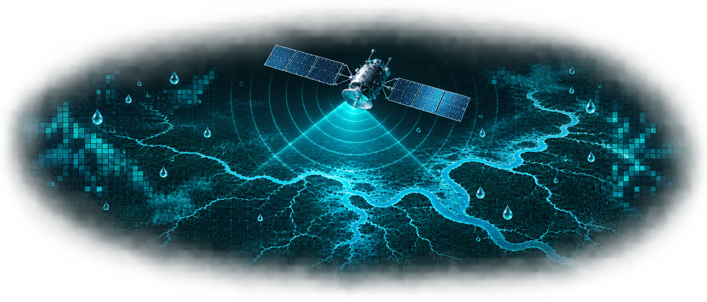
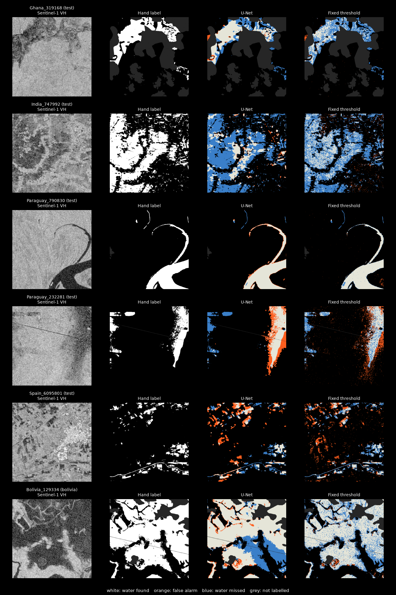

<!-- HERO -->
<p align="center">
  
</p>

<h1 align="center">
  
  &nbsp;sar-flood-mapping
</h1>

<p align="center">
  <strong>Finds flood water in Sentinel-1 satellite radar images, through cloud and at night</strong>
</p>

<p align="center">
  <a href="#results"></a>
  <a href="#results"></a>
  <a href="#install"></a>
  <a href="#usage"></a>
  <a href="LICENSE"></a>
</p>

<p align="center">
  <sub>A U-Net trained on the Sen1Floods11 benchmark, measured honestly against the classic radar threshold, exported to ONNX and served over HTTP. Trains in 12 minutes on a 4 GB laptop GPU.</sub>
</p>

<p align="center"></p>

## What is this?

Floods come with clouds, and clouds blind optical satellites. Radar sees through them, day or
night, and calm water shows up dark because it reflects the radar beam away from the satellite.
The catch: tarmac, sand and the shadow behind hills are dark too. This project measures how much
a learned model adds over the standard "dark pixel" threshold, and where it still fails.

- **Trains** a U-Net on 446 hand-labelled Sentinel-1 chips from 11 flood events
- **Evaluates** honestly: bootstrap confidence intervals, per-region scores, a country never seen in training, and leave-one-region-out retraining
- **Explains** its failures with a figure and a model card
- **Serves** predictions as an HTTP API using ONNX Runtime, no PyTorch needed at serve time

<p align="center">
  
  <br><sub>White: water found. Orange: false alarm. Blue: water missed. Grey: not labelled.</sub>
</p>

<p align="center"></p>

## Results

Water IoU (intersection over union; 1.0 is perfect), with 95% bootstrap intervals over images.
Baselines were tuned on the training split and the model's threshold on validation. Test and
Bolivia were used once, for these numbers.

| Tested on | U-Net (this repo) | Fixed VH threshold | Otsu per image |
|---|---|---|---|
| Official test split (90 chips, same flood events as training) | **0.676** (0.560-0.763) | 0.534 (0.422-0.616) | 0.231 |
| Bolivia (15 chips, a country never seen in training) | **0.590** (0.405-0.689) | 0.543 (0.389-0.635) | 0.404 |
| Leave-one-region-out: each region held out in turn, mean of 10 | **0.563** | 0.453 | |

> [!IMPORTANT]
> The official test split shares flood events with training, so it flatters any model. On Bolivia
> alone the gain is not statistically clear (the intervals overlap). Retraining with each region
> held out settles it: the model wins in **all 10 unseen regions**. If both methods were equally
> good, that would happen by chance about 2 times in 1,000 (two-sided sign test). The gain on new
> places is real, but smaller than the test split suggests: 0.563 against 0.676.

<table>
<tr>
<td width="50%" valign="top">

**Leave-one-region-out**

| Held out | Chips | U-Net | Threshold |
|---|---|---|---|
| Ghana | 53 | 0.445 | 0.379 |
| India | 68 | 0.546 | 0.453 |
| Mekong | 30 | 0.856 | 0.756 |
| Nigeria | 18 | 0.778 | 0.554 |
| Pakistan | 28 | 0.280 | 0.201 |
| Paraguay | 67 | 0.540 | 0.490 |
| Somalia | 26 | 0.343 | 0.140 |
| Spain | 30 | 0.712 | 0.597 |
| Sri Lanka | 42 | 0.616 | 0.568 |
| USA | 69 | 0.516 | 0.391 |

</td>
<td width="50%" valign="top">

**Where it fails**

- **Large, smooth water bodies are sometimes missed** (blue areas in the India and Bolivia rows). Training uses 256-pixel crops, so an all-water crop has little context.
- **River banks and wet fields are over-predicted** (orange edges in Paraguay).
- **Pakistan and Somalia score lowest.** The cause has not been investigated; the threshold is weakest there too.
- **Water under trees or between buildings** is invisible to C-band radar and missed by every method here.
- **Otsu, the textbook automatic threshold, fails** (0.23): most chips are mostly dry land, so it splits the land in two and calls half of it water.

Full metrics: [results.md](reports/unet_r34/results.md), [cv.json](reports/cv.json).

</td>
</tr>
</table>

<p align="center"></p>

## How it works

```text
 Sentinel-1 GRD chip (VV, VH in dB, ~10 m pixels)
          │
          ▼
 ┌──────────────────────┐   clip to training percentiles, add VV-VH,
 │  features + masks    │   mark NaN and unlabelled pixels as "ignore"
 └──────────┬───────────┘
            ▼
 ┌──────────────────────┐   ImageNet-pretrained ResNet-34 encoder
 │  U-Net               │   masked BCE + soft Dice (only ~10% is water)
 └──────────┬───────────┘   256-px crops, flips, rotations, AdamW, one-cycle
            ▼
 ┌──────────────────────┐   threshold chosen on validation only (0.45)
 │  evaluation          │   bootstrap CIs, per region, Bolivia, leave-one-region-out
 └──────────┬───────────┘
            ▼
 ┌──────────────────────┐   ONNX export, parity-checked against PyTorch
 │  ONNX Runtime        │   any image size: overlapping 512-px tiles, blended
 └──────────┬───────────┘
            ▼
 ┌──────────────────────┐   POST a GeoTIFF, get water km² as JSON
 │  FastAPI service     │   or a georeferenced water-mask GeoTIFF
 └──────────────────────┘
```

ONNX parity: largest logit difference to PyTorch 0.00008, water masks 100% identical on the
checked chips, about 205 ms per 512 x 512 chip on CPU.

<p align="center"></p>

## Install

```bash
git clone https://github.com/mahbub2649/sar-flood-mapping.git
cd sar-flood-mapping
make setup      # virtualenv + GPU build of PyTorch (CUDA 12.8) + requirements
make data       # hand-labelled Sen1Floods11 chips, ~730 MB, public bucket, no account
```

To serve without training, download the exported model from the
[latest release](https://github.com/mahbub2649/sar-flood-mapping/releases/latest) into `models/`.

> [!NOTE]
> On networks that advertise IPv6 but cannot route it, Python downloads hang. The data
> downloader always uses IPv4; for pretrained weights, `make train` passes `--ipv4`.

Verify:

```bash
make test
# 8 passed
```

<p align="center"></p>

## Usage

<details>
<summary><b>Train and evaluate</b></summary>

```bash
make baseline   # fixed and Otsu thresholds -> reports/baseline.json
make train      # ~12 min on an RTX 3050 Ti -> runs/unet_r34/
make evaluate   # test + Bolivia, bootstrap CIs, figure -> reports/unet_r34/
make cv         # leave-one-region-out, 10 trainings, ~1 h -> reports/cv.json
make export     # ONNX + parity check -> models/unet_r34.onnx
```

</details>

<details>
<summary><b>Run the API</b></summary>

```bash
make serve      # http://localhost:8100
curl localhost:8100/health
curl -F file=@data/S1Hand/Bolivia_103757_S1Hand.tif localhost:8100/predict
```

```json
{"model":"unet_r34","threshold":0.45,"pixels":262144,"valid_pixels":101623,
 "water_fraction":0.443,"water_km2":4.368,"observed_km2":9.85}
```

```bash
curl -F file=@scene.tif "localhost:8100/predict?format=geotiff" -o water_mask.tif
```

Input: a GeoTIFF with two bands, VV and VH in dB. The service rejects other band counts, files
over 200 MB, images over 8192 x 8192 pixels and linear (non-dB) values, and computes pixel area
from the file's coordinate system.

</details>

<details>
<summary><b>Use it from Python</b></summary>

```python
from floodseg.data import read_s1
from floodseg.infer import Predictor

model = Predictor("models/unet_r34.onnx", threshold=0.45)
mask = model.mask(read_s1("scene.tif"))   # 1 water, 0 dry, 255 no data
```

</details>

<p align="center"></p>

## Design decisions

1. **Beat a baseline, not a blank page.** A tuned threshold is what practitioners already use; every number is shown next to it.
2. **Never tune on test.** The decision threshold comes from validation; test and Bolivia were scored once.
3. **Score pixels you can trust.** Missing (NaN) and unlabelled pixels are left out of the loss and of every metric.
4. **Report uncertainty.** The bootstrap resamples whole images, because pixels inside one image are not independent.
5. **Distrust the official split.** It shares flood events with training, so leave-one-region-out measures the case that matters: a new place.
6. **Show the failures.** The figure and model card say where the model misses water, because a false "dry" in a populated area is the costly error.
7. **Serve without the training stack.** ONNX Runtime keeps the service small, and a parity test proves it matches PyTorch.
8. **Claim only what was measured.** Choices that were not compared, such as the VV-VH input and the architecture, are marked as untested.

<p align="center"></p>

## Project layout

```text
sar-flood-mapping/
├── floodseg/
│   ├── data.py        loading, scaling, masks, crops, augmentation
│   ├── baseline.py    fixed and Otsu thresholds
│   ├── model.py       U-Net and the masked loss
│   ├── train.py       training loop, validation threshold
│   ├── evaluate.py    bootstrap CIs, per-region table, figure
│   ├── cv.py          leave-one-region-out
│   ├── export.py      ONNX export and parity check
│   ├── infer.py       tiled inference with ONNX Runtime
│   └── serve.py       FastAPI service
├── scripts/           data download, baseline scoring
├── tests/             8 tests, including the API end to end
├── reports/           results, figure, cross-validation
├── models/            exported model metadata (ONNX file in releases)
├── MODEL_CARD.md      intended use, data, limits
└── Makefile
```

<p align="center"></p>

## Data and credit

Sen1Floods11: D. Bonafilia, B. Tellman, T. Anderson, E. Issenberg. *Sen1Floods11: A Georeferenced
Dataset to Train and Test Deep Learning Flood Algorithms for Sentinel-1.* CVPR Workshops, 2020.
Data by Cloud to Street, CC BY 4.0. Contains modified Copernicus Sentinel data.

## License

<p align="center"></p>
<p align="center"><sub>Code: MIT License © 2026 Md Mahbub Islam. Data: CC BY 4.0, see above.</sub></p>
